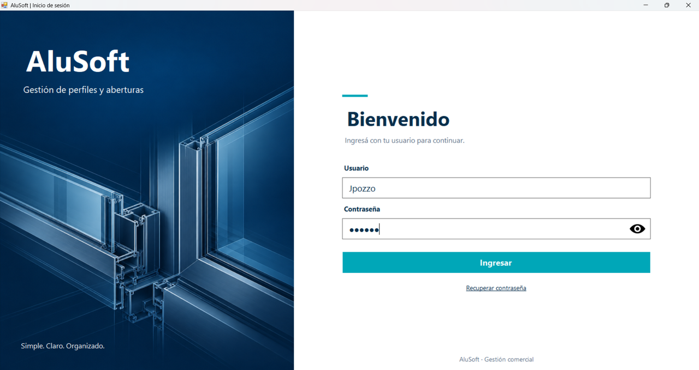
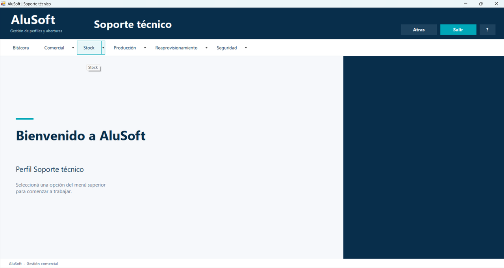
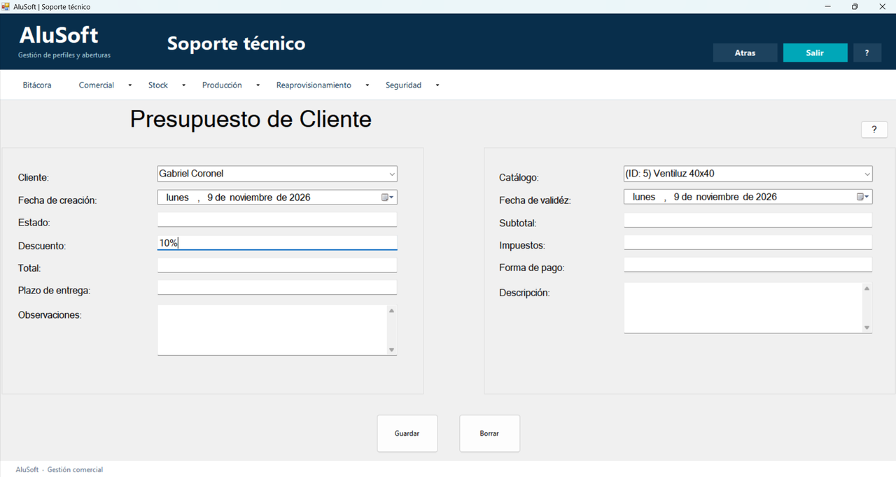
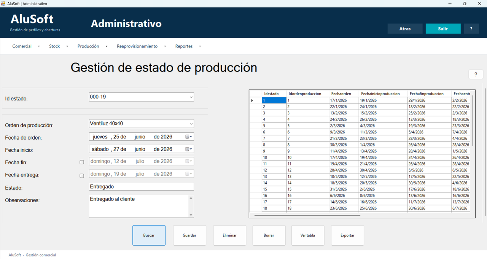
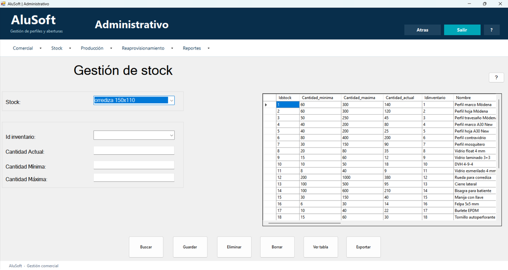
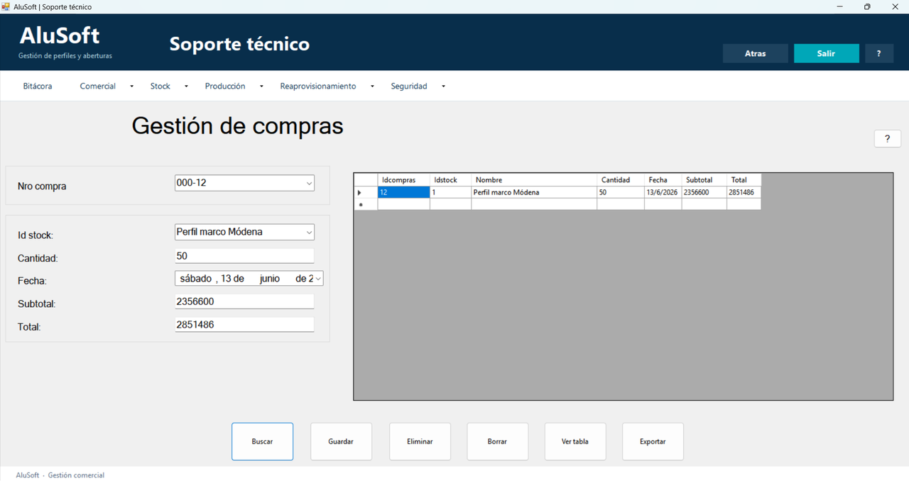
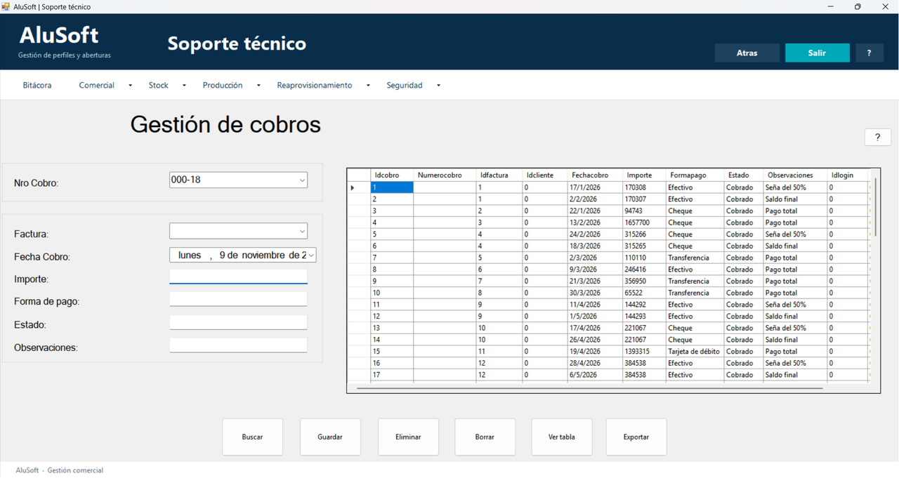
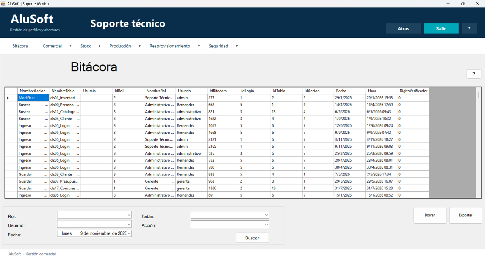
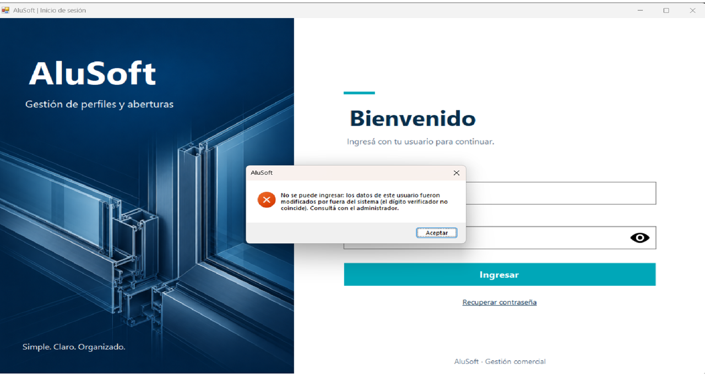

<div align="center">

# AluSoft

**Sistema de gestión integral para empresas de aberturas de aluminio**




</div>

## El problema

Muchas fábricas y comercios de aberturas todavía gestionan presupuestos, stock, producción y cobros con papel o planillas sueltas. Eso genera errores en los presupuestos, stock incierto, pedidos que se pierden y una fuerte dependencia de lo que recuerda cada empleado.

AluSoft centraliza todo ese circuito en una sola aplicación de escritorio, con acceso según el rol de cada usuario.

## Qué hace

| Área | Funciones |
| --- | --- |
| **Comercial** | Clientes, presupuestos de cliente, pedidos, ventas, facturas y cobros |
| **Producción** | Órdenes de producción y seguimiento del estado de cada trabajo |
| **Stock** | Inventario, catálogo de productos, stock y lista de precios |
| **Reaprovisionamiento** | Proveedores, presupuestos de proveedores, pedidos de reaprovisionamiento, remitos, compras y pagos |
| **Reportes** | Exportación a Excel de la información del negocio |
| **Seguridad** | Inicio de sesión con credenciales cifradas, menú por rol, bitácora, backup y control de integridad |

### Ciclo de venta

`Cliente` → `Presupuesto` → `Pedido` → `Orden de producción` → `Estado de producción` → `Venta y factura` → `Cobro`

### Ciclo de compra

`Proveedor` → `Presupuesto del proveedor` → `Pedido de reaprovisionamiento` → `Remito` → `Compra` → `Stock` → `Pago`

## Capturas

| | |
| --- | --- |
|  **Menú principal por rol** |  **Presupuesto de cliente** |
|  **Estado de producción** |  **Gestión de stock** |
|  **Compras a proveedores** |  **Cobros** |
|  **Bitácora de operaciones** |  **Control de integridad** |

## Roles

| Rol | Uso principal |
| --- | --- |
| **Gerente** | Supervisión general, reportes y decisiones |
| **Administrativo** | Clientes, presupuestos, facturación, compras y pagos |
| **Supervisor** | Órdenes y estados de producción |
| **Soporte técnico** | Usuarios, bitácora, backup y dígitos verificadores |

## Seguridad

- **Credenciales cifradas:** usuario y contraseña nunca se guardan en texto plano.
- **Bitácora:** cada operación importante queda registrada con fecha, hora, acción, tabla y usuario, y se puede filtrar y exportar a Excel.
- **Backup y restauración:** copia completa de la base (estructura y datos) en formato `.bacpac`.
- **Dígitos verificadores (DVH / DVV):** al iniciar sesión se verifica que los datos no hayan sido modificados por fuera del sistema. Si hay diferencias, solo Soporte técnico puede seguir operando hasta resolverlas.
- **Idiomas:** el selector de idioma (español, English, Français, Português) está implementado como demo en Gestión de Clientes.

## Arquitectura

Aplicación de escritorio en capas:

```
VISTA (Windows Forms)
   │
BLL   ── lógica de negocio
   │
DAL   ── acceso a datos mediante stored procedures (clsAcceso)
   │
SQL Server

BE    ── entidades compartidas entre capas
```

- Todo el acceso a datos se hace con **stored procedures**.
- Librerías externas: **ClosedXML** (exportación a Excel) y **DacFx** (backup).

## Requisitos e instalación

**Requisitos**
- Windows con **.NET Framework 4.7.2**
- **SQL Server** local con autenticación de Windows

**Pasos**
1. Restaurar la base de datos de AluSoft en SQL Server.
2. Ejecutar el instalador del proyecto `Alusoft-Instalador`, o abrir la solución en Visual Studio y compilarla.
3. Iniciar sesión con un usuario existente.

## Equipo

Proyecto final de **Prácticas Profesionalizantes 3**, Tecnicatura Superior en Análisis de Sistemas, **ISFT N° 172 "Alan Turing"**, Lomas de Zamora.

- Danel Fretes  danelfretes94@gmail.com
- Lautaro Villarreal  lautaroemmanuel.villa@gmail.com
- Brian Villarreal  brianvillarreal2450@gmail.com
- Thomas Velázquez  thomyvelazquez84@gmail.com
- Ezequiel Romero ezeromero61@gmail.com

Profesores: Javier Pozzo y Rocío Vargas.
